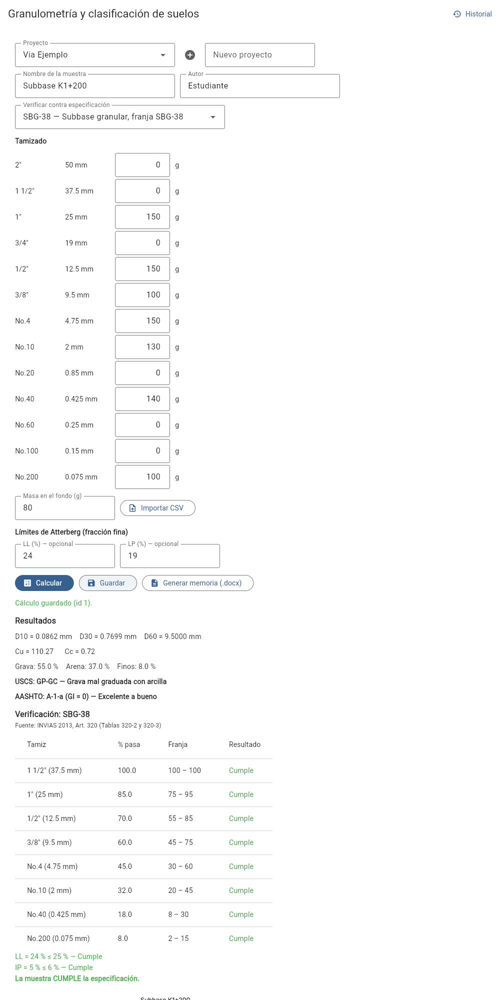

# granulometria-app

Aplicación de escritorio para **granulometría y clasificación de suelos**
(USCS y AASHTO), desarrollada para el Proyecto 02 de Programación II
(Semestre 2026-III, Universidad Distrital Francisco José de Caldas —
Ingeniería Civil). Corresponde al tema 5 del banco de temas del enunciado.

A partir de las masas retenidas en el tamizado, la app calcula la curva
granulométrica, los diámetros característicos (D10, D30, D60), los
coeficientes de uniformidad y curvatura (Cu, Cc), clasifica el suelo por
USCS (ASTM D2487) y AASHTO (AASHTO M 145 / ASTM D3282, con límites de
Atterberg), guarda los cálculos en una base de datos y genera
automáticamente una memoria de cálculo en Word con la curva incluida.



## Background

El proyecto reutiliza y amplía el repositorio `estates-2.0` (análisis de
vigas continuas) con un segundo subproyecto independiente, enfocado en
geotecnia. No modifica el paquete `estates/` existente: vive en su propia
carpeta `granulometria-app/`, con su propio entorno, dependencias y
pruebas.

| Requisito del enunciado | Dónde se cumple |
|---|---|
| Interfaz gráfica (Flet) | `app/ui/calculo_view.py`, `app/ui/historial_view.py`, `main.py` |
| Cálculo vectorizado (NumPy) | `app/modelo.py` (`np.cumsum`, `np.clip`) |
| Método numérico (SciPy) | `app/modelo.py` — `scipy.interpolate.interp1d` para D10/D30/D60 en escala semilogarítmica |
| Gráfico técnico (Matplotlib), reutilizado en el Word | `app/graficas.py` |
| Verificación contra especificaciones (husos) | `app/especificaciones.py` |
| Base de datos SQLite (2+ tablas relacionadas, CRUD, consultas parametrizadas) | `app/db.py` |
| Memoria de cálculo en Word autogenerada (docxtpl, tabla con ``, imagen embebida) | `app/reporte.py`, `plantillas/memoria.docx` |

## Install

Requiere Python 3.11 o superior (probado con 3.13).

```bash
cd granulometria-app
python -m venv .venv
.venv\Scripts\activate          # Windows (PowerShell)
# source .venv/bin/activate     # Linux/Mac
pip install -r requirements.txt
```

## Usage

```bash
python main.py
```

Se abre la ventana de la aplicación con dos vistas:

- **Cálculo** (vista inicial): elige o crea un proyecto, escribe el nombre
  de la muestra, ingresa las masas retenidas en cada tamiz (o impórtalas
  desde un CSV con columnas `tamiz`/`nombre` y `retenido_g`/`retenido`/
  `peso_g`), la masa en el fondo y, opcionalmente, los límites de Atterberg
  (LL y LP) para obtener la clasificación completa. Si eliges una
  **especificación** en el selector, también se verifica la curva contra su
  franja. El botón **Calcular** muestra D10/D30/D60, Cu, Cc, los
  porcentajes de grava/arena/finos, el símbolo USCS y el grupo AASHTO con su
  índice de grupo, la tabla de verificación (cumple / no cumple por tamiz y
  por criterio) y la curva granulométrica con la franja sombreada. **Guardar** registra el cálculo en la base de datos y
  **Generar memoria (.docx)** produce el informe en Word.
- **Historial**: lista los cálculos guardados (filtrables por proyecto o
  por nombre), con opción de ver el detalle, volver a generar la memoria o
  eliminar el registro.

### Especificaciones granulométricas

| Código | Material | Fuente |
|---|---|---|
| SBG-50, SBG-38 | Subbase granular (franja + LL ≤ 25 %, IP ≤ 6 %) | INVIAS 2013, Art. 320 |
| BG-40, BG-27, BG-38, BG-25 | Base granular (franja + relación No.200/No.40 ≤ 2/3) | INVIAS 2013, Art. 330 |
| TUB-GRAVA, TUB-SELECCIONADO | Cimentación de tuberías de acueducto (tamaño máximo y finos) | EMCALI NDC-SE-AA-012 |

Si el ensayo no incluye un tamiz de la franja, el valor se **interpola** en
escala semilogarítmica (se indica "interpolado"); si la abertura es mayor
que el tamiz más grande ensayado se asume 100 % ("100 %").

**Otras especificaciones** (afirmado, mezclas asfálticas, concreto, la norma
de tu empresa de acueducto, etc.): copia `ejemplos/especificaciones_propias.json`
a la raíz de `granulometria-app/` con el nombre `especificaciones_propias.json`
y reemplaza los valores por los de tu pliego. Al abrir la app aparecen en el
selector marcadas como `[propia]` y la memoria indica que no están
verificadas contra una norma publicada.

> **Verifica los valores con la norma vigente del contrato.** Las franjas
> incluidas se tomaron de los artículos INVIAS 2013; INVIAS actualiza sus
> especificaciones y cada empresa de acueducto tiene su norma (p. ej. la
> de la EAAB difiere de la de EMCALI).

### Uso como librería

El motor de cálculo no depende de Flet y se puede usar directamente:

```python
from app import servicio

filas = [
    {"nombre": "No.4", "abertura_mm": 4.75, "retenido_g": "0"},
    {"nombre": "No.10", "abertura_mm": 2.00, "retenido_g": "25"},
    {"nombre": "No.40", "abertura_mm": 0.425, "retenido_g": "100"},
    {"nombre": "No.200", "abertura_mm": 0.075, "retenido_g": "75"},
]
resultado = servicio.calcular(filas, peso_fondo_g=25.0, LL=25.0, LP=18.0)
print(resultado.uscs_simbolo, resultado.aashto.grupo)

ver = servicio.verificar_especificacion(resultado, "SBG-38")
print(ver.cumple, [(f.tamiz, f.pasa, f.cumple) for f in ver.filas])
```

## Verificación

```bash
pytest
```

60 pruebas (`tests/`) comprueban el programa de forma independiente:

| Caso | Solución comprobada |
|---|---|
| % retenido y % que pasa | Contra `np.cumsum` calculado a mano |
| D10, D30, D60 | Interpolación semilogarítmica ida y vuelta, y fórmula manual |
| Cu, Cc | Fórmulas Cu = D60/D10, Cc = D30²/(D10·D60) |
| Clasificación USCS | Casos límite GW, GP, SW, ML, CL, CH, MH y símbolo doble SP-SC |
| Clasificación AASHTO | Casos A-1-a, A-4, A-7-6 (con índice de grupo positivo) |
| Especificaciones | Cumple/no cumple por tamiz, LL/IP, relación No.200/No.40, interpolación semilog, tamiz sin dato, JSON propio válido e inválido, coherencia de las franjas incluidas |
| Tramos planos de la curva | D10/D30/D60 correctos cuando un tamiz no retiene masa (% que pasa repetido) |
| Base de datos | CRUD de proyectos y cálculos, borrado en cascada, búsqueda por nombre |
| Memoria Word | Generación, conteo de filas de la tabla, texto e imagen embebida |
| Entradas inválidas | Menos de 2 tamices, masa negativa, masa total cero, extrapolación fuera de rango |

Caso de referencia usado en varias pruebas y en la captura de pantalla:
tamices con 500 g totales (incluida la masa en el fondo) que producen
D10 ≈ 0.0945 mm, D30 ≈ 0.1936 mm, D60 ≈ 0.3822 mm, Cu ≈ 4.04, Cc ≈ 1.04;
con LL = 25 % y LP = 18 % clasifica como **SP-SC** (USCS) y **A-2-4**
(AASHTO, GI = 0).

## Limitaciones

- La clasificación USCS no cubre suelos altamente orgánicos (Pt) ni casos
  de suelo turboso; estos requieren inspección visual-manual (ASTM D2488),
  fuera del alcance de este programa.
- El índice de grupo AASHTO se calcula con la fórmula estándar, pero el
  programa no valida que el tamaño máximo de partícula sea compatible con
  el ensayo (p. ej. partículas mayores a 75 mm deberían excluirse antes del
  tamizado, según el estándar).
- La interpolación para D10/D30/D60 requiere que el porcentaje buscado
  esté dentro del rango efectivamente tamizado; si la curva no alcanza un
  valor (p. ej. no hay datos por debajo del 10 % que pasa), el cálculo
  lanza un error explicando qué faltó, en vez de extrapolar.
- La app se probó en modo escritorio (`flet run` / `python main.py`); el
  modo web (`ft.run(..., view=ft.WEB_BROWSER)`) funciona pero no es el modo
  de entrega esperado por el enunciado.

## Estructura del repositorio

```
granulometria-app/
├── app/
│   ├── modelo.py          # curva granulométrica, interpolación, USCS, AASHTO
│   ├── db.py               # SQLite: proyectos y calculos (CRUD, cascada)
│   ├── especificaciones.py # husos INVIAS / tuberías, verificación, JSON propio
│   ├── graficas.py         # curva granulométrica en escala semilog (Matplotlib)
│   ├── reporte.py          # memoria de cálculo en Word (docxtpl)
│   ├── servicio.py         # capa de orquestación entre UI, modelo, BD y reporte
│   └── ui/
│       ├── calculo_view.py     # formulario + resultados + importar CSV
│       └── historial_view.py   # listado, filtro, detalle y borrado
├── plantillas/memoria.docx # plantilla docxtpl (tabla con /)
├── ejemplos/
│   ├── capturas/            # capturas de pantalla de la app en funcionamiento
│   ├── especificaciones_propias.json  # plantilla para agregar tus especificaciones
│   └── memoria_ejemplo.docx # memoria generada con el caso de referencia
├── tests/
├── main.py
├── requirements.txt
└── .gitignore
```

## Contribution

Contributions are welcome. Please open an issue or submit a pull request.

## License

Este subproyecto se distribuye bajo los mismos términos que el repositorio
`estates-2.0`. Ver [LICENSE](../LICENSE) en la raíz del repositorio.
